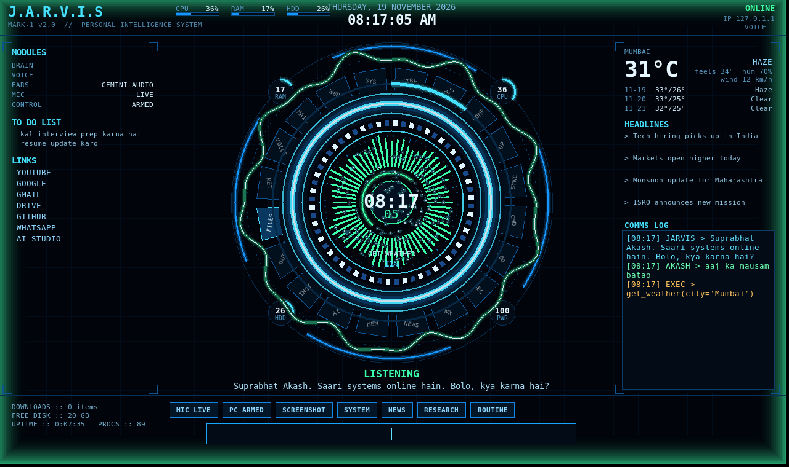

# JARVIS MARK-1

Your own Iron-Man-style voice assistant for Windows. Free. Yours.

Speak in Hindi/English mix. Jarvis listens, thinks, talks back in a deep Jarvis-style voice, and controls your whole PC: apps, files, browser, mouse, keyboard, screen, email, software installs, reminders, music, and more.
Everything here runs on FREE tools. No card. No plan. No payment.

## Setup (only once)

1. Install Python (free) from https://www.python.org/downloads/ - on the FIRST screen tick "Add Python to PATH", then Install. (Skip if already installed.)
2. Unzip the Jarvis folder (right click -> Extract All).
3. Get your free Gemini key: open https://aistudio.google.com/apikey, log in with Google, click "Create API key", copy it. No card needed.
4. Double-click `install.bat`. Wait 2-5 minutes. When it asks for the key, paste it (right-click in the window) and press Enter.
5. Double-click `run.bat`. Jarvis boots the HUD and says hello. Just speak!

Key not saved? Open `.env` in Notepad and paste it after `GEMINI_API_KEY=`.

## Every day

Double-click `run.bat`. Stop with "bye Jarvis" or close the window.
The dark window with the glowing arc reactor is your HUD: you can speak, or type in the box at the bottom.
No mic? Double-click `run_text.bat` and type instead.

## Ek baar me poora kaam (multi-step, insaan ki tarah)

Ek hi sentence me kitne bhi kaam bol do - Jarvis plan banata hai aur step-by-step karta hai, har step HUD ke log me dikhta hai:

- "Chrome kholke YouTube pe Kesariya chalao"
- "Chrome kholo, WhatsApp pe Rahul ko 'happy birthday bhai' likh do aur Enter daba do"
- "YouTube pe arijit singh ke gaane chalao aur notepad kholo"
- "Google pe linux interview questions search karo"
- "WhatsApp pe 919876543210 ko message karo 'meeting 5 baje hai'"

**Message bhejne ka rule:** Jarvis kisi ko message bhejne se pehle naam aur message padhkar poochhta hai ("Rahul ko ye bhejun? Haan ya nahi?"). Tum bolo "bina puche bhej do" to us command ko seedha bhej deta hai. Bolo "mat bhejo, sirf likh do" to type karke chhod deta hai - Enter tum khud dabao.

**Rokna ho to:** "ruk jao Jarvis" ya "stop karo" - chalta hua plan turant rukta hai. HUD ka PC ARMED/LOCKED switch pehle jaisa hi hai.

## Things you can say

- "Chrome kholo" / "Notepad kholo" / "Calculator open karo"
- "YouTube pe Arijit Singh ka gaana chalao" / "Arijit ka Tum Hi Ho chalao" / "next" / "pause"
- "Google pe Linux interview questions search karo"
- "Downloads folder kholo" / "Downloads me badi files dikhao" / "Downloads arrange karo"
- "Screenshot lo" / "Screen pe kya dikh raha hai?" / "Photo kheencho" (webcam, asks first)
- "Volume badha do" / "Volume 40 kar do" / "Mute karo" / "Brightness 50 karo"
- "Battery kitni hai?" / "PC ki RAM kitni use ho rahi hai?" / "Speed test karo"
- "10 minute baad yaad dilana paani peena hai" / "Reminders dikhao" / "Reminder cancel karo"
- "Chrome ko left karo" / "VS Code maximize karo" (window snapping)
- "Clipboard history dikhao" / "copy item 2" (last 50 copied things)
- "100 dollar kitne rupee?" / "Translate karo Hindi me: good morning"
- "25 minute focus mode" (quiet work timer)
- "Good morning" (weather + news + notes + battery briefing)
- "Dictation shuru karo" (whatever you say gets typed) / "dictation band"
- "Meeting mode start" / "meeting khatam" (notes in Documents/Jarvis-Meetings)
- "VLC install karo" / "7zip uninstall karo" (free official winget, verifies after install)
- "Settings me dark mode on karo" (Jarvis drives the mouse/keyboard like a human; slam the mouse into a screen corner to stop it)
- "Kal shaam 6 baje meeting add karo" (opens Google Calendar pre-filled, you press Save)
- "Naya tool banao jo ..." (Jarvis writes itself a new tool - asks you first, keeps a backup)
- "Update check karo" (new version from GitHub)

## The HUD

Arc-reactor core with orbiting particles, holographic boot sequence, live voice waveform ring, gauges (CPU / RAM / HDD / battery), weather + 3-day forecast, headlines, notes, quick links, comms log, task progress ring, screen-edge glow while listening.
Buttons at the bottom: **MIC LIVE/MUTED** and **PC ARMED/LOCKED** (the big red switch: Jarvis cannot touch the PC while LOCKED).

## Safety (always)

Jarvis ALWAYS asks ("haan" or "nahi") before: deleting files (they go to the Recycle Bin), installing or removing programs, downloading files, taking over mouse/keyboard, shutdown/restart, closing apps, moving/overwriting files, running commands, sending email or WhatsApp (unless you said "bina puche bhej do" in that command), taking a webcam photo, or changing its own code.
Every action is saved in `data/action_log.txt`. Self-changes are backed up in `data/backups/` - "last change undo karo" restores them.

## Optional free upgrades (in `.env`)

- **Better Hindi hearing**: free Groq key at https://console.groq.com/keys (no card) -> `GROQ_API_KEY=` (Whisper, more accurate than Gemini hearing)
- **Voice**: `GEMINI_VOICE=Alnilam` (deep, default) or Achird / Algieba / Charon / Orus. Free backup voice when Gemini is busy: `VOICE=hi-IN-MadhurNeural` (male) or hi-IN-SwaraNeural (female)
- **Offline backup brain**: say "apne aap ko upgrade karo" - Jarvis checks your PC, installs Ollama (free), downloads a model that fits your RAM, and auto-switches when the Gemini free limit ends
- **Gmail read/send**: Google Account -> Security -> 2-Step Verification -> App passwords -> fill `GMAIL_ADDRESS=` and `GMAIL_APP_PASSWORD=`
- **Google Calendar read**: Calendar settings -> Integrate calendar -> Secret address in iCal format -> `GCAL_ICAL_URL=`
- **Phone remote (Telegram)**: message @BotFather, `/newbot`, paste the token in `.env` (`TELEGRAM_BOT_TOKEN=`), message your bot, paste the chat id it replies (`TELEGRAM_CHAT_ID=`). Commands: /status /shot /lock /shutdown /open /download /say /note /ask
- **Face greeting**: `FACE_GREETING=true` (local OpenCV, nothing saved or uploaded)
- **Voice gate**: `VOICE_GATE=pin` (say "jarvis unlock 1 2 3 4"), `voiceprint` (say "enroll voice" once), or `both`. The voiceprint check is basic and local, not bank-grade; typing in the window is never blocked.

## Honest limits

- Free Gemini has per-minute/per-day limits. When it runs out, Jarvis says so and (if you set up Ollama) switches to the local brain for 30 minutes. Local models are weaker, and weaker in Hindi.
- Jarvis controls the PC only while it is running. It cannot wake a sleeping PC or unlock Windows.
- Needs internet for hearing, thinking and voice (except the optional local brain).
- Windows admin popups ("Yes/No") during installs still need your click.
- WhatsApp Web flow needs WhatsApp Web already logged in (one-time QR scan in Chrome). Pehli baar slow ho sakta hai - page load hone ka wait karta hai.

## Development

- `run_tests.bat` - 43 offline tests (no mic/screen/internet needed)
- GitHub Actions runs the tests on Windows + Linux on every push
- Self-update: "update check karo" pulls the newest version from this repo (public repo: works as-is; private repo: put GITHUB_TOKEN in `.env`)

Built with love by Akash and his Instinct. MIT license - see LICENSE.
